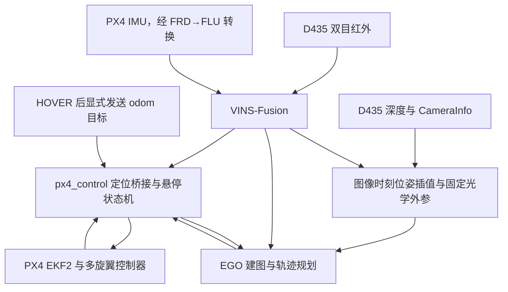

# RoboMaster 2027 自主飞行无人机控制

自主飞行无人机 ROS 2 工作空间，主分支面向 **Ubuntu 22.04 / ROS 2 Humble**。
当前主流程为 **D435 双目 + PX4 IMU → VINS-Fusion → PX4 EKF2 外部视觉融合 → 显式起飞与悬停 → EGO 固定目标规划 → PX4 执行**。
D435 深度图用于 EGO-Planner 局部建图，轨迹由原有 `px4_control` 管理器统一采样和发送。

**执行入口为 `/px4_control/goal`，只在起飞完成后的 HOVER 接受目标。**
独立 `ego_preview.launch.py` 仍只做规划预览。工业相机 + VINS-Mono 流程保留为独立入口，默认不启用 EGO 执行。

本文按 2026-11-25 的 `main` 源码与配置整理。串口、标定、固件消息版本和保护参数应与实际设备一致。
各包与第三方目录保留的 README、许可证仍适用于相应组件。

## 目录

- [1. 分支与包结构](#1-分支与包结构)
- [2. 数据链路与坐标系](#2-数据链路与坐标系)
- [3. 环境依赖与编译](#3-环境依赖与编译)
- [4. PX4 固件 DDS 话题准备](#4-px4-固件-dds-话题准备)
- [5. 飞控参数](#5-飞控参数)
- [6. 时间戳与传感器配置](#6-时间戳与传感器配置)
- [7. 实机启动与显式控制](#7-实机启动与显式控制)
- [8. mindvision_camera：相机驱动](#8-mindvision_camera相机驱动)
- [9. driver_interface：传感器接口](#9-driver_interface传感器接口)
- [10. px4_control：悬停管理器](#10-px4_control悬停管理器)
- [11. 分阶段验收和日志](#11-分阶段验收和日志)
- [12. 验证范围与当前边界](#12-验证范围与当前边界)
- [13. 旧版本升级与项目结构](#13-旧版本升级与项目结构)
- [14. 参考](#14-参考)
- [15. 开源协议与第三方来源](#15-开源协议与第三方来源)

## 1. 分支与包结构

`main` 使用 Ubuntu 22.04 / ROS 2 Humble；`ubuntu20.04` 是单独维护的 Foxy 分支，
不要直接套用本页的主分支启动配置。工作空间默认分包安装，生成目录为 `build/`、`install/`、`log/`。

| 路径 | 职责 |
| --- | --- |
| `src/bringup` | 定位、上位机总入口、EGO 预览、Mono 与串口 agent 的 launch 和总配置 |
| `src/d435_bringup` | D435 数据流、分辨率、曝光、旋转和驱动启动配置 |
| `src/driver_interface` | PX4 `SensorCombined` → ROS IMU；可选的工业相机灰度转换 |
| `src/ego_depth_inputs` | 独立 C++ 深度适配包；可靠接收深度、图像时刻的预测位姿插值、固定外参、延迟诊断 |
| `src/vins_fusion_ros2` | 双目 + IMU VINS-Fusion ROS 2 移植、预测发布与标定配置；普通源码目录 |
| `src/px4_control` | 外部定位、健康检查、起飞/悬停/降落和 EGO 轨迹执行；C++17 / rclcpp / Eigen3 |
| `src/ego-planner-swarm` | EGO-Planner ROS 2 fork，使用 Git 子模块锁定版本 |
| `src/drone_visualization` | 从里程计位姿生成四旋翼 MarkerArray |
| `src/px4_msgs` | 直接纳入版本管理的 PX4 消息；已按指定固件提交适配，见第 4 节 |
| `src/mindvision_camera` | MindVision 工业相机驱动 |
| `src/VINS-Mono` | 由外层 Git 管理的 VINS-Mono ROS 2 源码，作为保留流程 |

主入口与组件范围：

| 启动入口 | 启动内容 |
| --- | --- |
| `bringup onboard_control.launch.py` | `localization` + `px4_control` + `ego_preview` |
| `bringup localization.launch.py` | 串口 agent、IMU 接口、D435、VINS-Fusion、默认 world→odom、可选四旋翼模型 |
| `bringup ego_preview.launch.py` | 深度适配器和 EGO 规划器；传感器/VINS/TF 由外部提供 |
| `ego_depth_inputs ego_depth_inputs.launch.py` | 单独运行 C++ 深度适配器；通过 `config_file` 指定参数文件 |
| `px4_control px4_control.launch.py` | 仅 PX4 定位桥接与悬停管理器，默认加载 Mono 配置 |
| `bringup vins_system.launch.py` | 工业相机 + PX4 IMU + VINS-Mono；见第 7.4 节 |
| `bringup vins_system_sim.launch.py` | 仿真时间下的 VINS-Mono；相机/IMU 需由外部仿真提供 |

## 2. 数据链路与坐标系

### 2.1 定位、控制与规划



Fusion 的 `/imu_propagate` 是前向传播状态，`/odometry` 是视觉后端输出。
`px4_control` 使用前者发送外部定位，同时监视后者，避免后端停止优化后仅靠 IMU 传播仍被判定健康。
Fusion ROS 节点当前通过 **20 ms 定时器**发布数据，因此 `/imu_propagate` 的发布上限约为 **50 Hz**，
输入 IMU 的频率与内部积分频率不能直接当成该话题的发布频率。

后端校正后，预测器在同一互斥保护下更新基准并重放缓存 IMU，追赶到实际 IMU 样本后才保存预测；
ROS 读取端仅返回时间戳前进的预测，避免重复发布旧样本和暴露重传播中间状态。

`px4_control` 在 HOVER 接受目标并转发到 `/ego_execution/goal`，订阅 EGO 的三次 B 样条。
以 50 Hz 在 ROS 时间下计算位置、速度和加速度，并复用外部定位的冻结航向/原点变换转换到 PX4 NED：
位置有旋转和平移，速度与加速度只旋转。PX4 使用位置闭环及速度/加速度前馈，yaw 保持起飞/接管时的值。
悬停时速度/加速度仍为 NaN；jerk 和 yaw 角速度始终为 NaN。只有原管理器发送 Offboard 心跳，不启动另一个轨迹发送器。

### 2.2 TF 与机体约定

| TF 边/状态 | 发布者或含义 |
| --- | --- |
| `world → odom` | `localization` 默认发布单位静态变换；未来全局纠偏节点接管前应关闭该静态发布 |
| `odom → body` | VINS-Fusion 后端位姿；`body` 原点为 VINS IMU 原点 |
| `body → camera` | VINS 的 cam0 标定外参；当前 `camera` 对应旋转后的 infra2 |
| `camera → camera_link` | 深度适配器结合物理 infra2 到设备根的外参，补齐标定系与设备系之间的连接 |
| `camera_link → RealSense 各 frame` | RealSense 驱动内部外参 |
| PX4 外部定位 | 已对齐的 NED 位置/速度，body FRD→NED 姿态，四元数 wxyz |

`localization.yaml` 默认 `world_frame_id: odom`、`publish_identity_world_to_odom: true`。
全局纠偏接入后，将后者设为 false，让纠偏节点独占 `world → odom`，局部控制继续使用连续 `odom`。
不要把回环跳变直接注入局部控制反馈。

VINS 初始 yaw 和原点任意。`px4_control` 第一次用时间差不超过 0.1 s 的 PX4 姿态匹配 VINS，
固定航向和原点变换；若 PX4 局部位置有效则用它作原点锚，否则从局部零点开始。
该变换运行中保持固定。飞行中不要重启 VINS、reset 管理器或更换变换。

VINS 线速度在其世界/局部参考系中表达，虽然 `child_frame_id=body`；
参数 `vins_velocity_frame: world` 表达的是速度约定，不要求 frame 名必须为 `world`。
IMU 接口已做 FRD→FLU，因此默认 `imu_from_body_xyzw: [0, 0, 0, 1]`；该安装旋转不是相机外参。

## 3. 环境依赖与编译

### 3.1 获取源码与 EGO 子模块

```bash
git clone --branch main https://github.com/Spaaaace-yyj/RM_flying_robot_control.git
cd RM_flying_robot_control
git submodule update --init --recursive
git submodule status
```

`.gitmodules` 中 EGO 使用 SSH 地址，需要当前机器有 GitHub SSH 权限。
没有 SSH 密钥时，可仅在本工作区改用 HTTPS，再初始化子模块：

```bash
git config submodule.src/ego-planner-swarm.url https://github.com/Spaaaace-yyj/ego-planner-swarm.git
git submodule update --init --recursive
```

这只修改本地 Git 配置，不修改仓库 `.gitmodules`。后续若运行 `git submodule sync`，需重新设置本地 HTTPS 地址。
子模块应使用外层仓库锁定的提交，不使用 `--remote` 自动升级。
VINS-Mono、VINS-Fusion 和 px4_msgs 是普通源码目录，无需分别初始化。

### 3.2 安装依赖

先安装 Ubuntu 22.04 和 ROS 2 Humble。以下命令在仓库根目录执行，构建使用系统 Python；
如果当前启用了 Conda，先退出该环境。

```bash
source /opt/ros/humble/setup.bash
sudo apt update
sudo apt install -y   git build-essential cmake pkg-config   python3-colcon-common-extensions python3-rosdep python3-yaml python3-numpy python3-opencv   libopencv-dev libeigen3-dev libceres-dev libgoogle-glog-dev   libpcl-dev libarmadillo-dev   libboost-filesystem-dev libboost-program-options-dev libboost-system-dev   libboost-thread-dev libboost-date-time-dev   ros-humble-ament-cmake-auto ros-humble-ament-cmake-test   ros-humble-cv-bridge ros-humble-camera-info-manager   ros-humble-image-transport ros-humble-image-transport-plugins   ros-humble-message-filters ros-humble-visualization-msgs   ros-humble-tf2-ros ros-humble-tf2-ros-py ros-humble-tf2-geometry-msgs   ros-humble-pcl-conversions ros-humble-pcl-ros ros-humble-laser-geometry   ros-humble-realsense2-camera ros-humble-diagnostic-updater   ros-humble-ros2launch ros-humble-rosbag2 ros-humble-rosbag2-storage-default-plugins

# 仅首次使用 rosdep 且尚未初始化时执行：sudo rosdep init
rosdep update
rosdep install --from-paths src --ignore-src --rosdistro humble -y
```

串口总入口还需要 `MicroXRCEAgent` 在 PATH 中；当前 Dockerfile 单独构建 **v2.4.2**。
RealSense 驱动的图像旋转行为需与标定及深度适配约定一致，见第 7.2 节。
可视化/标定工具按需安装 `ros-humble-foxglove-bridge`、`ros-humble-rviz2`、
`ros-humble-rqt-image-view`、`ros-humble-camera-calibration`。

### 3.3 编译

```bash
source /opt/ros/humble/setup.bash
CMAKE_BUILD_PARALLEL_LEVEL=2 MAKEFLAGS=-j2 colcon build --symlink-install --executor sequential --packages-up-to bringup   --cmake-args -DCMAKE_BUILD_TYPE=Release -DBUILD_TESTING=OFF   -DPython3_EXECUTABLE=/usr/bin/python3 -DPYTHON_EXECUTABLE=/usr/bin/python3
source install/setup.bash
```

`bringup` 已依赖 Fusion、Mono、PX4 控制和 EGO；`--packages-up-to bringup` 会构建其依赖链。
内存紧张的 A7Z/NX 可将上面的两处并行数都降为 1。
根目录 `build.sh` 使用 `bash build.sh` 执行，会构建整个工作空间，不限制并行数。

仅更新已安装依赖环境中的 launch、YAML 或显示包时：

```bash
colcon build --symlink-install --packages-select bringup drone_visualization   --cmake-args -DCMAKE_BUILD_TYPE=Release -DBUILD_TESTING=OFF
source install/setup.bash
```

仅编译工业相机和接口可用 `--packages-up-to mindvision_camera driver_interface`；
将 `bringup` 也列入选择会同时带入 EGO 等依赖。

### 3.4 A7Z ARM64 Docker

```bash
# 原生 ARM64 主机，仓库根目录；构建上下文必须包含已初始化的 EGO 子模块
git submodule update --init --recursive
docker build -f Dockerfile.a7z --build-arg BUILD_JOBS=2 -t rm-flight:humble-arm64-v4 .
docker compose up -d
docker compose exec rm-dev bash
```

`compose.yaml` 的 `/home/radxa/Code/RM_flying_robot_control/src` 是当前开发机路径，
在其他机器上先改为实际源码目录。镜像带 MicroXRCEAgent 和 Foxglove Bridge，
entrypoint 加载 ROS、agent 和 `/ws/install`；进入交互终端后可执行：

```bash
source /opt/ros/humble/setup.bash
source /opt/xrce-agent/local_setup.bash
source /ws/install/setup.bash
ros2 launch bringup onboard_control.launch.py
```

镜像构建保留 `/ws/install`，会删除 `/ws/build` 和 `/ws/log`；compose 仅挂载 `/ws/src`。
因此重新创建容器不会保留容器内后续生成的构建缓存。修改挂载源码后需要在 `/ws` 重新编译相关包；
镜像内初次构建未使用 symlink 安装，修改源 YAML/launch 不会直接更新安装目录。

## 4. PX4 固件 DDS 话题准备

当前 `px4_msgs` 已按固件提交 **`d6f12ad1c4f70ad3230afd7d86e971421e02fef4`** 适配，
不能再按未修改的 release/1.14 消息包理解。消息字段、版本号、DDS 话题名必须与实际刷入固件一致；
更换固件时同时核对 ROS 消息和节点订阅，不要只按“v1.17”或“main”标签判断兼容。

`px4_control` 当前使用的 PX4 接口如下（`px4_namespace` 默认 `/fmu`）：

| 方向 | 话题 | 类型 |
| --- | --- | --- |
| 输入到 ROS | `/fmu/out/vehicle_status_v1` | `px4_msgs/msg/VehicleStatus` |
| 输入到 ROS | `/fmu/out/vehicle_local_position_v1` | `px4_msgs/msg/VehicleLocalPosition` |
| 输入到 ROS | `/fmu/out/vehicle_attitude` | `px4_msgs/msg/VehicleAttitude` |
| 输入到 ROS | `/fmu/out/timesync_status` | `px4_msgs/msg/TimesyncStatus` |
| 输入到 ROS | `/fmu/out/estimator_status_flags` | `px4_msgs/msg/EstimatorStatusFlags` |
| 输入到 ROS | `/fmu/out/vehicle_command_ack` | `px4_msgs/msg/VehicleCommandAck` |
| ROS 到飞控 | `/fmu/in/vehicle_visual_odometry` | `px4_msgs/msg/VehicleOdometry` |
| ROS 到飞控 | `/fmu/in/offboard_control_mode` | `px4_msgs/msg/OffboardControlMode` |
| ROS 到飞控 | `/fmu/in/trajectory_setpoint` | `px4_msgs/msg/TrajectorySetpoint` |
| ROS 到飞控 | `/fmu/in/vehicle_command` | `px4_msgs/msg/VehicleCommand` |

IMU 接口另订阅 `/fmu/out/sensor_combined`。`_v1` 后缀是当前节点实际订阅名，
不能仅在终端查看无后缀话题来判断链路已经连通。

若固件缺少融合标志或命令应答，可将以下条目合并到其
`src/modules/uxrce_dds_client/dds_topics.yaml` 的 `publications`：

```yaml
  - topic: /fmu/out/estimator_status_flags
    type: px4_msgs::msg::EstimatorStatusFlags
  - topic: /fmu/out/vehicle_command_ack
    type: px4_msgs::msg::VehicleCommandAck
```

`src/px4_control/config/px4_dds_additions.yaml` 是历史补充示例，不是整个 DDS 文件，
也不是 ROS 参数文件。不要覆盖已有 publications/subscriptions；按实际板型重新编译、刷入固件。
默认总配置为 `/dev/ttyAS4`、**1500000 baud**，必须与飞控设置相同，且同一链路只运行一个 agent。

```bash
ros2 topic info -v /fmu/out/vehicle_status_v1
ros2 topic info -v /fmu/out/vehicle_local_position_v1
ros2 topic echo /fmu/out/estimator_status_flags --once --qos-reliability best_effort
ros2 topic echo /fmu/out/timesync_status --once --qos-reliability best_effort
```

缺少必需话题会导致 WAIT_READY，具体原因见 `/px4_control/status`。

## 5. 飞控参数

下表保留原悬停方案的参数起步参考，不代表当前飞控已被自动设置成这些值。
实际参数名称、枚举和生效条件以所刷固件的 QGroundControl 元数据为准；旧 v1.14 文档不能代替指定固件定义。
通过 QGroundControl 保存原始参数，再设置针对室内 VINS 的参数。节点不自动写飞控
参数，不绕过预飞检查，也不改你已经调好的机架/电机/姿态 PID。

| 参数 | 本方案起步设置/检查 |
| --- | --- |
| `EKF2_EV_CTRL` | 11，外部水平位置+高度+yaw；速度确认可信后可评估 15 |
| `EKF2_HGT_REF` | 3，外部视觉高度参考；重启后生效 |
| `EKF2_EV_NOISE_MD` | 0，消息方差并受飞控噪声参数下限约束 |
| `EKF2_EV_QMIN` | 0；桥接没有校准质量分数，quality=-1 表示未知 |
| `EKF2_EV_DELAY` | 先核对采样时间，再根据 ULog 评估剩余延迟，单位 ms |
| `EKF2_EV_POS_X/Y/Z` | 外部 pose 原点，即 VINS IMU，相对重心的 FRD 坐标，单位 m |
| `COM_OF_LOSS_T` | 例如 0.5 s，需在完整 PX4 上验证失联行为 |
| `COM_OBL_RC_ACT` | 室内可选择 4（Land），同时验证定位失效、RC 接管等场景 |

其他传感器融合按实机设置确认。室内测试若要验证完全依赖 VINS 的定位，就不要让
已有 GNSS/其他外部源掩盖 VINS 故障；但不要机械地关掉气压计/磁力计/预飞检查。
保持 RC 接管通道和你已验证的飞控失效保护。姿态控制器需先能稳定手动飞行。

`EKF2_EV_POS` 是 **消息所报告位置原点** 的杆臂，不要填 Kalibr 的相机到 IMU
平移。用飞控 IMU 做 VINS 时，测量该 IMU 在机体重心的前/右/下方向偏移。
若以后在桥接中补偿到机体重心，这里也要相应改零，避免重复补偿。

管理器发布的方差是 `position_stddev` 等参数的平方，和 `acc_n/gyr_n` 不是同一种
噪声。原起步方案不默认融合 VINS 速度，是为了先验证速度约定、延迟，并避免将同源 IMU
传播速度当成独立高可信观测；打开速度融合要结合 innovation 与飞行记录评估。

## 6. 时间戳与传感器配置

当前桥接按 uXRCE-DDS 已将 PX4 时间映射到 ROS 时钟域设计，发送 ROS 时间，
**不会再次减去 timesync 的 estimated_offset**。实际固件需验证 `timestamp`、
`timestamp_sample` 与相机/VINS header 是否处于同一时基。
`driver_interface` 的实机配置使用 `timestamp_mode: px4`、`timestamp_offset_sec: 0.0` 和 FRD→FLU。
实机各组件保持 `use_sim_time: false`。

### 6.1 当前 D435 / VINS-Fusion 配置

| 项目 | 当前配置 |
| --- | --- |
| 深度/红外分辨率与帧率 | 848×480 @ 30 FPS |
| cam0 / `image0_topic` | `/camera/camera/infra2/image_rect_raw`，引用 `left.yaml` |
| cam1 / `image1_topic` | `/camera/camera/infra1/image_rect_raw`，引用 `right.yaml` |
| IMU | `/px4/imu`，来自飞控而非 D435 |
| 图像旋转 | RealSense `rotation_filter.enable: true`，180° |
| 红外曝光/增益 | 自动曝光关闭，`exposure: 3000`、`gain: 16` |
| 红外散斑 | `depth_module.emitter_enabled: 0` |
| 深度处理 | 不对齐 RGB；当前关闭空间/时间/补洞等后处理 |
| 外参 | `estimate_extrinsic: 0`，使用配置中的 `body_T_cam0/1` |
| 时间偏移 | `estimate_td: 0`，`td: 0.0021954063551311784` s，约 2.195 ms |
| VINS 运行 | 双目 + IMU、多线程，当前 GPU 加速选项均关闭 |

这里的 cam0/cam1 名称对应当前旋转成像和标定配置，不按设备的物理左右标签自行交换。
`td` 约定为 **`t_imu = t_image0 + td`**，与 `EKF2_EV_DELAY` 含义不同。
旧提交中约 73/98 ms 的 `td` 不属于当前标定；每次录包分析需记录源码/标定版本。
更换安装、曝光、分辨率、旋转或时间映射后重新核对标定，不能把该值作为其他设备的通用参数。

### 6.2 保留的工业相机 / Mono 配置

相机硬件 tick 映射与首帧到达锚定不能等同于相机和 IMU 硬同步。
`first_arrival`、`ros_now` 可用于联调，不作为已验证的最终同步方案。
Mono 控制前应在自己的标定文件使用：

```yaml
image_topic: /image_raw
imu_topic: /px4/imu
estimate_extrinsic: 0
estimate_td: 0
loop_closure: 0
save_image: 0
```

`td` 保留该设备验证后的值。仓库通用 `euroc_config_px4.yaml` 仍有回环/保存图像设置，
应复制自己的配置并通过 `vins_config_file:=` 传入。Fusion 配置结构不同，不要把 Mono 的选项整段照搬到 Fusion。

## 7. 实机启动与显式控制

### 7.1 总入口与配置路径

构建后在仓库根目录执行：

```bash
source /opt/ros/humble/setup.bash
source install/setup.bash
ros2 launch bringup onboard_control.launch.py
```

默认同时启动定位、PX4 管理器和 EGO 固定目标规划。启动后等待显式起飞服务；进入 HOVER 后还需显式发送目标，才会执行 EGO 轨迹。
仅运行定位，或者在定位已运行时单独增加规划预览，可分别使用：

```bash
# 定位入口包含 agent、相机、IMU、VINS 和模型显示
ros2 launch bringup localization.launch.py
# 已有定位/深度/TF 的另一终端；不要与总入口重复启动
ros2 launch bringup ego_preview.launch.py
```

| 配置文件 | 内容 |
| --- | --- |
| `bringup/config/onboard_control.yaml` | `localization` 与 `control` 两段配置引用，控制/预览的仿真时间选项 |
| `bringup/config/localization.yaml` | agent 串口、各组件配置引用、VINS 启动延时/参考系、模型开关 |
| `bringup/config/driver_interface.yaml` | IMU 输入/输出、时基与轴变换，默认关闭图像桥接 |
| `d435_bringup/config/d435.yaml` | D435 数据流与旋转配置 |
| `vins_fusion_ros2/config/euroc/euroc_d435_imu_config.yaml` | 双目/IMU 话题、内参文件引用、外参与 td |
| `px4_control/config/px4_control_vins_fusion.yaml` | 总入口使用的 Fusion 话题、门限和起飞高度 |
| `bringup/config/ego_preview.yaml` | EGO 建图与轨迹参数，节点为 `/ego_preview/planner` |
| `ego_depth_inputs/config/ego_depth_inputs.yaml` | C++ 适配器的订阅 QoS、预测位姿缓存、等待/年龄门限和外参模式 |
| `drone_visualization/config/drone_visualization.yaml` | 模型话题、尺寸、颜色和更新率 |

总入口和定位入口都只接受一个 `config_file`：

```bash
ros2 launch bringup onboard_control.launch.py config_file:=/绝对路径/onboard_control.yaml
ros2 launch bringup localization.launch.py config_file:=/绝对路径/localization.yaml
```

引用路径支持绝对路径、`~`、环境变量；相对路径在 `config_package` 非空时相对于该包的 share 目录，
否则相对于引用它的总配置所在目录。VINS 的 `left.yaml`、`right.yaml` 相对于 VINS 配置解析。
EGO 预览与执行共用 `config/ego_preview.yaml` 的建图、相机和坐标参数；`planner_config_file`
在此基础上叠加覆盖参数。总入口叠加 `config/ego_execution.yaml` 中的速度/加速度与障碍膨胀设置，
使用 `/ego_execution/goal`，目标先经过控制管理器检查。共享配置默认 `grid_map/skip_pixel: 4`，
避免切换执行入口后丢失 A7Z 的深度降采样设置。

`startup_delay_s: 8.0` 仅延迟 VINS-Fusion，agent、相机和 IMU 接口立即启动。
自定义配置省略该项时不延迟。延时采用 wall time，不依赖 `/clock`。
自定义回放配置时，定位、相机、控制/预览中的 `use_sim_time` 需分别保持一致。

### 7.2 EGO 深度建图与规划预览

深度适配已迁移到独立 C++ 包 `ego_depth_inputs`，运行程序为 `ego_depth_inputs_node`，
节点名仍是 `/ego_depth_inputs`。旧 `bringup/scripts/ego_depth_inputs.py` 已删除，
升级安装 bringup 时也会清理其旧安装入口，无需重新创建 Docker 容器。

适配器与当前 RealSense ROS **4.58.4** 的旋转/CameraInfo 约定配套：
该约定下 180° 旋转图像仍沿用原物理光学系内参。节点按字节对旋回 16UC1 深度，
保留大小端像素值，处理行填充，并保持深度、内参、相机位姿三个输出的原始采样时间戳一致。
更换驱动、对齐目标或旋转方式时，需重新检查像素、内参和光学轴关系。

默认 `pose_source: imu_propagate`：

1. 深度输入默认 Reliable / Volatile，CameraInfo 默认 Best Effort / Volatile；两者按精确时间戳配对。
2. 缓存 `/imu_propagate`，在图像采样对应的 IMU 时刻对机体位置做线性插值、姿态做最短弧 SLERP。
   `camera_imu_time_offset_s` 沿用当前 VINS 标定的 `td`（约 2.195 ms），约定为 `t_imu = t_image + td`；
   更换标定时同步修改，不要把等待后端的约 0.4 s 延迟填进该参数。三个输出仍使用原图像时间戳。
3. 启动时从标定 TF 链读取并冻结 `body → 深度光学系` 的固定外参，随后组合该外参与图像时刻机体位姿。
   因此每帧不再等待视觉后端发布的动态 TF。此模式要求刚性安装、`estimate_extrinsic: 0`；
   修改标定、安装或重启定位后应重启适配器。
4. 只发布最新可用的配对帧，丢弃更旧积压；队列有界，默认最多等待 0.25 s、接受 0.5 s 内的图像，
   位姿插值不跨越大于 0.1 s 的采样缺口。所有时间匹配使用整数纳秒，仅允许至多 1000 ns 的端点舍入容差，
   不允许用过时机体位姿代替当前观测，也不外推缺失的运动。

独立启动时可在自己的参数文件设置 `pose_source: tf`，恢复原来严格按图像时刻查询 TF 的模式，
用于其他定位源或对比测试。不会在预测位姿缺失时静默退回后端 TF。
`bringup ego_preview.launch.py` 新增 `input_config_file` 参数来选择适配器配置；原有
`use_sim_time`、`images_rotated_180` 和 `publish_camera_bridge` 参数继续有效。
例如：

```bash
ros2 launch bringup ego_preview.launch.py input_config_file:=/绝对路径/ego_depth_inputs.yaml
```

`/ego_input/status`（JSON，1 Hz）报告配对/发布/丢弃计数、输出频率、最新输出年龄、最新位姿年龄和等待原因。
短暂等待不会刷 WARN；连续超过 `stall_warning_s`（默认 0.5 s）无输出时才报警。
诊断不替代实际延迟测试：C++ 迁移和预测位姿模式去掉了 Python 开销及逐帧后端 TF 等待，
但相机时间映射、DDS、定位输入仍可能造成延迟，部署后需测量：

```bash
ros2 topic echo /ego_input/status
ros2 topic delay /ego_input/camera_pose
```

| 话题 | 用途 |
| --- | --- |
| `/imu_propagate` | EGO 使用的 `odom` 系机体里程计 |
| `/ego_input/depth` | 适配后的 16UC1 深度 |
| `/ego_input/camera_info` | 匹配的深度内参 |
| `/ego_input/camera_pose` | 深度光学系在 `odom` 中的位姿 |
| `/ego_input/status` | C++ 适配器输出年龄、频率、丢弃计数及等待原因 |
| `/ego_preview/goal` | `geometry_msgs/msg/PoseStamped` 三维目标，frame 必须为 `odom` |
| `/ego_preview/planning/bspline` | `traj_utils/msg/Bspline`；总入口接入执行，独立预览不驱动飞控 |
| `/ego_preview/grid_map/occupancy_inflate` | 膨胀占据栅格点云 |
| `/ego_preview/optimal_list` | 轨迹可视化 |

等待定位和建图输入建立后，可发送示例目标（单位 m，按当前 `odom` 原点修改）：

```bash
ros2 topic pub --once /ego_preview/goal geometry_msgs/msg/PoseStamped   '{header: {frame_id: odom}, pose: {position: {x: 1.0, y: 0.0, z: 0.8}, orientation: {w: 1.0}}}'
```

该命令只生成预览。默认规划最大速度 2.0 m/s、最大加速度 3.0 m/s²、分辨率 0.1 m、
深度比例 1000，完整参数见 `ego_preview.yaml`。这些是规划配置，不表示已完成该速度下的实机验收。
`onboard_control` 会从所引用的 D435 YAML 读取是否旋转 180°；独立预览需自行保持参数一致：

```bash
# 未旋转成像时使用，标定和 TF 也必须与之匹配
ros2 launch bringup ego_preview.launch.py images_rotated_180:=false
```

### 7.3 起飞、悬停、降落与复位

```bash
ros2 topic echo /px4_control/status
ros2 topic hz /odometry
ros2 topic hz /imu_propagate
ros2 topic hz /fmu/in/vehicle_visual_odometry
ros2 topic info -v /fmu/in/offboard_control_mode
```

初始化 VINS 后等待状态 READY。默认 `allow_arm_requests: false`，由 RC 解锁，再显式调用：

```bash
ros2 service call /px4_control/takeoff std_srvs/srv/Trigger '{}'
```

管理器捕获 PX4 当前 XY/yaw，先发送 1.5 s 目标和心跳，再请求并确认 Offboard，
按 0.25 m/s 逐步抬升目标。**Fusion 默认相对上升 0.8 m，Mono 默认 1.0 m**，不是离地绝对高度。
只有显式配置 `allow_arm_requests: true` 才允许服务请求后由管理器发解锁命令。

```bash
# 已经由 RC 起飞并低速运动时，捕获当前位置与 yaw 悬停
ros2 service call /px4_control/hold std_srvs/srv/Trigger '{}'
# 请求飞控 AUTO.LAND
ros2 service call /px4_control/land std_srvs/srv/Trigger '{}'
# 地面已上锁、恢复定位后，清除锁定并重新对齐；不会重启 VINS
ros2 service call /px4_control/reset std_srvs/srv/Trigger '{}'
```

模式和解锁以 VehicleStatus 确认为准，ACK 接受不代表已完成切换。
遥控接管后不会自动抢回 Offboard；不要同时运行另一套 Offboard 心跳节点。
故障、reset 条件和详细门限见第 10 节。

### 7.3.1 起飞后发送固定目标并执行

总入口已连接整条链路，无需额外启动 `traj_server` 或另一套 Offboard 控制器：

```bash
ros2 launch bringup onboard_control.launch.py
```

初始化并由 RC 解锁后调用 `/px4_control/takeoff`，等待 `/px4_control/status` 的 `state` 为
`HOVER` 且 `ready: true`、`armed: true`。然后按现场位置发送目标，例如：

```bash
ros2 topic pub --once /px4_control/goal geometry_msgs/msg/PoseStamped \
  '{header: {frame_id: odom}, pose: {position: {x: 1.0, y: 0.0, z: 0.8}, orientation: {w: 1.0}}}'
```

这是 **odom 中的绝对三维位置，单位为米**，不是相对前进 1 m，也不是 PX4 NED；
先查看 `/imu_propagate` 的当前位置和地图。可省略时间戳（零时间戳在接收时处理），
非零时间戳须在 1 s 内。目标 orientation 当前不控制 yaw。
例如 `(1,0,1)` 是 odom 中的固定位置；机头前方 1 m 应由当前机体位置加上机头在 odom
中的水平单位方向向量计算，z 按所需的绝对高度设置。管理器接收目标时打印
`goal_odom`、`vehicle_odom`、`forward_odom` 和 `displacement_odom`，可直接核对方向与距离。
每次只执行一个目标；规划期间保持原悬停点，收到有效轨迹后进入 `TRACK_TRAJECTORY`，
只有轨迹到期且实际位置/速度达到门限才确认到点，返回 `HOVER`。之后可再次发送目标。
若当前位置已在目标 0.15 m 内，接受为原地悬停，不再把重复目标当成距离过小的错误。

```bash
# 随时取消目标，捕获当前位置交给 PX4 制动并悬停
ros2 service call /px4_control/hold std_srvs/srv/Trigger '{}'
# 结束飞行
ros2 service call /px4_control/land std_srvs/srv/Trigger '{}'
# 查看接受/拒绝原因、执行状态和轨迹编号
ros2 topic echo /px4_control/status
```

初始限制：单次目标距离不超过 **3 m**，目标及整条轨迹的 odom 高度在 **0.3–2.2 m**；
执行规划配置为 **0.5 m/s、0.8 m/s²**，管理器对连续曲线的导数控制点另检查
**0.8 m/s、1.5 m/s²** 上限，并限制轨迹在起点周围 5 m 内。
这些坐标高度依赖 VINS 初始化原点，**不等同于离地高度**，应按现场标定调整。

5 s 无可接受规划、45 s 任务超时、0.8 s 无新深度曝光位姿或执行中的规划器心跳、
超过 0.6 m 跟踪误差、无效/不连续轨迹及 EGO 紧停轨迹，都会取消任务；定位/PX4 健康时保持当前位置。
收到旧轨迹不会自动恢复，需重新发目标。位置捕获交由 PX4 制动，仍存在制动距离。
定位或飞控状态故障沿用原 LAND/失联处理，遥控切出后不自动抢回。
当前只接受终点位于授权停靠区域内的完整轨迹段，不支持长航程、途经点队列或摇杆连续导航。

默认采用附近停靠：原始目标空闲时保持原坐标；原始目标占据、处于膨胀区或越界时，
在其**同一 odom 高度、水平半径 0.5 m** 内搜索已观测、未占据且未膨胀的栅格位置。
优先选择距原目标最近的位置，等距时优先机体一侧。找到候选点后仍须成功规划并通过整段
碰撞、速度、加速度、轨迹连续性和高度检查；没有候选点或可执行轨迹时保持悬停。
不会因目标被挡住而穿过障碍，也不会自动改变目标高度。

规划器打印 `Using nearby free stop`，执行端打印请求位置、轨迹终点和 `adjustment_m`。
第一条有效轨迹确定实际停靠点，后续重规划须维持该停靠点及原请求区域的约束；
到点按实际停靠点判断，完成时显示 `nearby goal reached`。
运行中的停靠点随后被占据时取消并悬停，需要重新发目标。
`/px4_control/status` 的 `ego_requested_goal_odom` 为原请求，`ego_goal_odom` 在接收首条轨迹后
为实际停靠点，`ego_nearby_goal_radius_m` 为允许的调整半径。
同时调整 Fusion 控制配置的 `ego/nearby_goal_radius` 和执行规划配置的
`fsm/nearby_goal_radius`；两者默认均为 0.5 m，设为 0 恢复严格终点，允许范围为 0–2 m。
这些参数启动时读取，修改后重新启动节点；独立预览默认不启用附近停靠。

管理器拒绝时会分别给出距离、odom 高度或起始速度及对应门限，不再合并为一条无法区分的提示。

执行配置启用 `optimization/fixed_terminal: true`：EGO 在优化前设置终端边界，
固定最后三个控制点，并在时间重分配后重新约束终点，保证授权目标处的零末速度。
发布前检查整条轨迹及终点的占据情况。独立预览保留默认的自由终点优化。
若出现 `spline endpoint does not match...`，日志会分别给出 `position_error_m` 和
`terminal_speed_mps`；应先核对锁定的 EGO 子模块、已编译节点和实际参数，保留执行端门限。
收到成功规划时管理器会打印 `EGO spline accepted`，实际发送轨迹时状态为 `TRACK_TRAJECTORY`；
EGO 自身的 `EXEC_TRAJ` 仅表示规划器正在运行其轨迹计时，不能单独确认飞控在执行。

固定目标在规划前检查占据情况，附近搜索也失败时回到等待目标，并通过
`/ego_preview/planning/rejected_goal` 原样回传请求的时间戳、坐标系和位置。
管理器只结束与当前请求完全匹配的任务，迟到的旧回复不会取消新目标；不再反复优化同一个
已知无效终点。此话题可通过 `ego/rejected_goal_topic` 配置。

上游 EGO 同样可能规划失败：优化失败或精修后碰撞会返回失败，FSM 会重试，
执行中遇到深度超时或迫近碰撞则可能紧停。上游的默认滚动规划/自由终点与这里的完整
停靠任务不同；`Fixed goal rejected` 是本项目增加的提前终点检查。
附近停靠放宽目标位置要求，不取消路径可行性和飞控健康检查。

目标拒绝日志中的 `reason` 分别为 `outside_map`（越界）、`occupied`（原始栅格占据）、
`inflation_only`（原始格空闲但膨胀后占据），并列出目标/机体坐标、原始/膨胀值和地图边界。
启动日志 `EGO map` 打印实际加载的几何参数。执行配置的 0.25 m 膨胀在 0.1 m 栅格上
向上取整为 3 格，采用立方体膨胀，每轴延伸约 0.3 m；应结合机体尺寸和定位误差调整。
无效的地图尺寸/分辨率在启动时明确报错，避免基础参数未加载时把所有目标都当作越界。
在 RViz/Foxglove 中使用 `odom`，同时查看原始 `/ego_preview/grid_map/occupancy` 和
膨胀 `/ego_preview/grid_map/occupancy_inflate`，区分真实障碍、膨胀覆盖和投影异常。

任务到点、超时、hold、land、定位故障或遥控接管取消任务时，管理器会向
`/ego_preview/planning/cancel` 发送 `std_msgs/msg/Empty`，使 EGO 清除目标并等待新任务，
避免降落后仍按旧目标持续重规划。该话题可以通过 `ego/cancel_topic` 配置。

| 话题/配置 | 作用 |
| --- | --- |
| `/px4_control/goal` | 用户发目标的唯一执行入口，`geometry_msgs/msg/PoseStamped` |
| `/ego_execution/goal` | 管理器检查后转发给规划器；不作为用户操作入口 |
| `/ego_preview/planning/bspline` | 规划轨迹；仅在有效目标任务内接受 |
| `/ego_preview/planning/data_display` | EGO 执行循环心跳 |
| `/ego_preview/planning/cancel` | 管理器通知 EGO 清除任务，回到等待目标状态 |
| `/ego_preview/planning/rejected_goal` | EGO 回传被拒绝的当前目标；管理器按请求身份关联 |
| `/ego_input/camera_pose` | 与适配深度同帧发布的曝光位姿，用于感知时效检查 |
| `/px4_control/status` | `ego_state`、`ego_reason`、原请求 `ego_requested_goal_odom`、实际停靠点 `ego_goal_odom`、轨迹编号等诊断 |
| `px4_control/config/px4_control_vins_fusion.yaml` | `ego/*` 接口、任务和执行门限，默认启用 |
| `bringup/config/ego_execution.yaml` | 总入口专用规划参数及 0.25 m 障碍膨胀半径 |

地图与曲线仍使用第 7.2 节的可视化话题，显示 frame 选 `odom`。
独立 `ego_preview.launch.py` 的 `/ego_preview/goal` 仅做预览，不会授权执行。
首次验证先在仿真/受控环境确认轨迹方向、遥控接管和 hold/land，再做短距离低速实机测试。

### 7.4 保留的工业相机 / VINS-Mono 入口

当前相机 YAML 默认输出 `/image_gray`，bringup 的图像桥接关闭，而通用 Mono 配置订阅 `/image_raw`。
因此不要直接把无参数 `vins_system.launch.py` 当作已匹配的控制配置。
推荐显式加载配套传感器配置和自己的标定：

```bash
SENSOR_CONFIG="$(ros2 pkg prefix --share bringup)/config/camera_interface.yaml"
ros2 launch bringup vins_system.launch.py   camera_config_file:="$SENSOR_CONFIG" driver_config_file:="$SENSOR_CONFIG"   vins_config_file:=/绝对路径/你的Mono标定.yaml   use_pose_graph:=false use_rviz:=false   agent_device:=/dev/ttyAS4 agent_baud:=1500000
```

上述配套配置使用 30 FPS、mono8、`/image_raw` 和仅 IMU 转换；具体曝光、翻转仍按标定检查。
此入口不启动控制管理器。已有传感器和 VINS 后，在另一终端运行：

```bash
ros2 launch px4_control px4_control.launch.py
```

Mono 使用 `/vins_estimator/imu_propagate`、`/vins_estimator/odometry` 和 `world` 参考系。
当前 `px4_control` 对 PX4 版本话题的要求仍适用，不因切换 Mono 自动退回旧固件接口。
仿真入口 `vins_system_sim.launch.py` 仅运行仿真时间的 VINS，外部模拟器负责图像/IMU。

### 7.5 Foxglove / RViz 模型显示

定位默认启动 `drone_visualization`，订阅 `/imu_propagate`，最多 20 Hz 发布 `/drone/markers`。
模型在里程计 header 的坐标系中显示，当前主流程为 **`odom`**；橙色标识机头/前旋翼，蓝色为后旋翼。
Foxglove 3D 面板选择 `odom`，启用 `/drone/markers`、`/path` 及第 7.2 节的 EGO 点云/轨迹话题。
默认 world→odom 存在时也可在 world 查看，但不要将其理解为已经获得全局绝对定位。

```bash
ros2 launch foxglove_bridge foxglove_bridge_launch.xml
# 未由 localization 启动模型时才单独运行
ros2 launch drone_visualization drone_visualization.launch.py
```

模型过期门限默认 0.5 s；输入停更或时间戳过旧会隐藏。参数在
`drone_visualization/config/drone_visualization.yaml`，修改后重启。

### 7.6 深度建图 rosbag 回放

在线总入口运行时，录制原始深度、内参、VINS 传播和完整 TF：

```bash
ros2 bag record -o ego_preview_inputs   /camera/camera/depth/image_rect_raw /camera/camera/depth/camera_info   /imu_propagate /tf /tf_static
```

记录完成后确认 `/tf_static` 含 `camera → camera_link` 及 RealSense 内部外参。
回放这类完整录包时，不再启动实机定位或 PX4 控制：

```bash
ros2 launch bringup ego_preview.launch.py use_sim_time:=true publish_camera_bridge:=false
# 另一终端
ros2 bag play ego_preview_inputs --clock --topics   /tf /tf_static /imu_propagate   /camera/camera/depth/image_rect_raw /camera/camera/depth/camera_info
```

如果录包缺少 `camera → camera_link`，但保留物理 infra2→设备根的 TF，可改为
`publish_camera_bridge:=true` 由适配器补齐。避免与录包同时发布同一条 TF 边。
回放后按第 7.2 节发送 odom 目标；时钟回退时建议重新启动预览节点再从头播放。

## 8. mindvision_camera：相机驱动

ROS 2 迈德威视相机包，提供 MindVision 相机的 ROS API。
上游原始环境为 Ubuntu 20.04 + ROS 2 Galactic；本仓库 `main` 分支面向
Ubuntu 22.04 + ROS 2 Humble。新增格式/帧率功能需要在本机相机上验证，
不代表已验证所有相机型号。

### 8.1 相机输出控制

`output_encoding:=rgb8` 或 `mono8` 控制节点输出格式，不管哪种编码，图像话题
都使用同一个 `image_topic`（默认 `/image_gray`，可用 launch 参数改成 `/image_raw`），
不会按格式自动改话题。

```bash
# 全速 RGB，保留原有行为
ros2 launch mindvision_camera mv_launch.py full_speed:=true output_encoding:=rgb8

# 30 FPS 灰度；也可把 mono8 改成 rgb8 发布 30 FPS 彩色
ros2 launch mindvision_camera mv_launch.py \
  full_speed:=false target_fps:=30 output_encoding:=mono8 \
  use_sensor_data_qos:=true qos_depth:=1

# 使用自定义配置文件（仍可同时用上述参数显式覆盖）
ros2 launch mindvision_camera mv_launch.py config_file:=/绝对路径/camera_params.yaml
```

节点内默认值（`config/camera_params.yaml` 会覆盖）：`full_speed: true`、
`target_fps: 30`、`output_encoding: rgb8`、`use_sensor_data_qos: false`、
`qos_depth: 1`。`target_fps` 为正整数，全速模式下忽略；这些参数需要重启节点生效。

| 参数 | 默认 | 作用 |
| --- | --- | --- |
| `full_speed` | `true` | 全速采集/发布；`false` 启用限帧 |
| `target_fps` | `30` | 限帧目标，整数 Hz；全速时忽略 |
| `output_encoding` | `rgb8` | `rgb8` 彩色或 `mono8` 灰度，灰度路径由 `use_isp` 选择 |
| `use_isp` | `false` | `false` 节点内 Bayer→灰度去马赛克（满帧率）；`true` 走 SDK ISP（Jetson 约 27 fps） |
| `image_topic` | `/image_raw`（节点默认） | 两种编码共用的图像话题；`camera_params.yaml` 中为 `/image_gray` |
| `use_sensor_data_qos` | `false` | `true` 使用 Best Effort；VINS 建议开启 |
| `qos_depth` | `1` | 传输队列深度 |

新参数文件使用 `/**`；launch 同时兼容旧 `/mv_camera` 和 `/camera_node` 配置。
`frame_id` 参数也会实际应用于图像及 CameraInfo 的消息头。

`mono8` 且 `use_isp: false` 时，节点直接用 `bayerGB8_to_gray()` 在
`CameraImageProcess()` 之前去马赛克：BAYGB8 布局中绿色像素位于 `(x + y)` 为偶数的
位置，R/B 像素复用其左右两个绿色邻居的均值。这绕开了 SDK ISP 流水线的吞吐瓶颈。

限帧先尝试硬件设置；不支持则按硬件图像时间戳在 `CameraImageProcess()` 前
跳过多余帧。软件限帧只降低 ISP/ROS 负载，不保证降低 USB 带宽。
SDK 灰度不需要在另一个节点执行 RGB 到灰度转换。每秒日志分别打印取帧与发布频率。

灰度输出配合 `driver_interface enable_image_bridge:=false` 时，VINS 直接订阅
`/image_raw`（需把 `image_topic` 设为 `/image_raw`，例如用
`src/bringup/config/camera_interface.yaml`）。

### 8.2 编译与启动

```bash
# 使用本仓库已包含的相机驱动，在仓库根目录执行
source /opt/ros/humble/setup.bash
rosdep install --from-paths src --ignore-src -r -y
colcon build --symlink-install --packages-up-to mindvision_camera
source install/setup.bash
```

```bash
ros2 launch mindvision_camera mv_launch.py
```

主要 launch 参数：

1. `config_file`：相机参数文件的路径；
2. `camera_info_url`：相机内参文件的路径；
3. `use_sensor_data_qos`：相机 Publisher 是否使用 SensorDataQoS（默认 `false`）。

`src/mindvision_camera/mvsdk/` 已带 x86_64 与 arm64 的 `libMVSDK.so`，CMake 会按
`CMAKE_SYSTEM_PROCESSOR` 自动选择。

### 8.3 标定

标定教程可参考 <https://navigation.ros.org/tutorials/docs/camera_calibration.html>，
参数意义请参考 <http://wiki.ros.org/camera_calibration>。
标定后的相机参数会被存放在 `/tmp/calibrationdata.tar.gz`。

```bash
# 按实际图像话题选择 /image_gray 或 /image_raw
ros2 run camera_calibration cameracalibrator --size 8x11 --square 0.02000 image:=/image_gray
```

### 8.4 通过 rqt 动态调节相机参数

打开 rqt，在 Plugins 中添加 `Configuration -> Dynamic Reconfigure` 及
`Visualization -> Image View`。可在线调节 `exposure_time`、`analog_gain`、
`rgb_gain.r/g/b`、`saturation`、`gamma`、`flip_image`；其余格式/帧率/QoS 参数为
启动只读，改后需重启节点。

### 8.5 验证范围

早期说明引用的 `src/mindvision_camera/test/frame_rate_limiter_test.cpp` 和
`tests/test_sensor_launch_parameters.py` 不属于当前受跟踪源码，不能直接执行旧测试命令。
现有驱动应在相机上检查输入/输出帧率、mono8 编码、时间戳单调性和 QoS 连接情况；
相机、SDK、真实 DDS 的行为不能仅凭 launch 文件语法检查确认。

## 9. driver_interface：传感器接口

面向 ROS 2 Humble 的 PX4 IMU / 图像接口，同时供 VINS-Fusion 和 VINS-Mono 使用。
节点支持以下转换；当前主流程只启用 IMU 转换：

| 输入 | 处理 | 输出 |
| --- | --- | --- |
| 工业相机 `/image_raw` | 可选灰度转换 | mono8 `/image_gray` |
| PX4 `/fmu/out/sensor_combined` | IMU 字段、轴和时间戳转换 | `sensor_msgs/msg/Imu` `/px4/imu` |

### 9.1 功能

- 将 `rgb8`、`bgr8`、`rgba8`、`bgra8` 等图像转换为 `mono8`；
- 保留相机消息原始 `header.stamp`，默认保留原始 `frame_id`；
- 将 PX4 `gyro_rad` 和 `accelerometer_m_s2` 转为 `sensor_msgs/msg/Imu`；
- 默认进行 PX4 FRD 到 ROS FLU 的坐标变换：`(x, y, z) -> (x, -y, -z)`；
- 使用 PX4 `SensorCombined.timestamp`，而不是每帧都使用回调到达时间；
- 相机、PX4 输入以及转换后的输出均采用 Sensor Data QoS；
- 检测并默认丢弃非单调 IMU 时间戳。

`SensorCombined` 不包含姿态，因此输出消息设置 `orientation_covariance[0] = -1`。

### 9.2 只接收 IMU，不接收图像

启动参数 `enable_image_bridge` 默认为 `true`（保留原行为）。设为 `false` 时既不
创建图像订阅器，也不创建灰度发布器，IMU 转换保持不变：

```bash
ros2 launch driver_interface driver_interface.launch.py enable_image_bridge:=false
```

也可以在 YAML 中设置 `enable_image_bridge: false`；总 launch 使用的是
`bringup/config/driver_interface.yaml` 或显式传入的 `driver_config_file`。
只有显式传入的启动参数才会覆盖 YAML。改变开关后重启节点。

相机直接输出 `mono8` 时，话题仍然是 `image_topic`（`camera_interface.yaml` 里为
`/image_raw`），此时 VINS 配置使用 `image_topic: "/image_raw"`、
`imu_topic: "/px4/imu"`，不需要灰度中转节点。桥接开启时则使用 `/image_gray`
（以实际 `gray_output_topic` 为准），输入和输出不能指向同一话题，也不要让两个
节点同时发布同一灰度输出话题。

### 9.3 编译、DDS 环境与启动

```bash
# 在本仓库根目录执行
source /opt/ros/humble/setup.bash
rosdep install --from-paths src --ignore-src -r -y
colcon build --symlink-install \
  --packages-up-to driver_interface \
  --cmake-args -DCMAKE_BUILD_TYPE=Release
source install/setup.bash
```

按当前 PX4 链路设置 DDS 环境：

```bash
export ROS_DOMAIN_ID=0
export ROS_LOCALHOST_ONLY=0
export RMW_IMPLEMENTATION=rmw_fastrtps_cpp
```

默认话题启动：

```bash
ros2 launch driver_interface driver_interface.launch.py
```

如果工业相机实际话题为 `/mv_25001498/image_raw`：

```bash
ros2 launch driver_interface driver_interface.launch.py \
  camera_input_topic:=/mv_25001498/image_raw
```

也可以直接运行节点并加载参数文件：

```bash
ros2 run driver_interface driver_interface_node --ros-args \
  --params-file "$(ros2 pkg prefix --share driver_interface)/config/driver_interface.yaml"
```

### 9.4 配置 VINS-Mono

在自己的 VINS 配置中修改：

```yaml
image_topic: "/image_gray"   # 关闭图像桥接且相机直出灰度时用 "/image_raw"
imu_topic: "/px4/imu"
```

第一次测试自己的相机和 IMU 外参时可以使用 `estimate_extrinsic: 2`，
稳定后应使用离线标定结果并改为 `estimate_extrinsic: 0`。
外参必须对应本节点输出的 `imu_link_flu` 坐标系，而不是 PX4 原始 FRD 坐标系。

### 9.5 时间戳模式

参数 `timestamp_mode` 有四种值：

**`auto`（节点代码默认，联调用）**：节点比较第一条 `SensorCombined.timestamp` 和当前 ROS
时间。如果两者相差不超过 `auto_direct_threshold_sec`（默认 10 秒），说明
PX4/uXRCE-DDS 已经将时间映射到 ROS 时基，直接使用 PX4 时间；如果相差很大，
说明收到的可能是飞控启动时间，自动退化为下面的 `first_arrival` 固定偏移方式。

**`first_arrival`（快速联调）**：第一条 IMU 到达时只计算一次
`clock_offset = ros_now - px4_timestamp`，后续使用
`t_ros = t_px4 + clock_offset + timestamp_offset_sec`。这样保留 PX4 IMU 的采样
间隔，不会把每次 DDS/串口传输抖动写入时间戳。但第一次消息的传输延迟会成为固定
误差，因此它适合快速跑通，不替代硬件同步。

**`px4`（正式同步链路）**：`t_ros = t_px4 + timestamp_offset_sec`。只有在 PX4
时间已经被映射到与相机相同的时基，或者你已经准确计算出 `timestamp_offset_sec`
时使用。实机悬停使用此模式。

**`ros_now`（只用于连通测试）**：使用回调到达时间。DDS、USB 和串口抖动会进入
时间戳，不适合最终 VIO。

启动时覆盖参数：

```bash
ros2 launch driver_interface driver_interface.launch.py \
  timestamp_mode:=px4 \
  timestamp_offset_sec:=0.0
```

VINS 的 `estimate_td: 1` 只能补偿近似固定的相机—IMU 时间偏移，不能消除随机
传输抖动。

### 9.6 检查输出

确认输入存在：

```bash
ros2 topic info -v /image_raw
ros2 topic info -v /fmu/out/sensor_combined
```

检查灰度图像：

```bash
ros2 topic hz /image_gray
ros2 topic echo /image_gray --once --field encoding
ros2 run rqt_image_view rqt_image_view /image_gray
```

编码应为 `mono8`。检查 IMU：

```bash
ros2 topic hz /px4/imu
ros2 topic echo /px4/imu --once
```

水平静止且采用 FLU 时，预期：

- 角速度接近 `(0, 0, 0)` rad/s；
- 加速度模长约为 `9.8 m/s^2`；
- 水平且 IMU `z` 轴朝上时，`z` 应接近 `+9.8 m/s^2`（取决于安装方向）。

检查图像与 IMU 时间戳是否处于同一时基：

```bash
ros2 topic echo /image_gray --once --field header.stamp
ros2 topic echo /px4/imu --once --field header.stamp
```

两者不应相差飞控启动时间或 Unix 纪元量级。

### 9.7 参数表

| 参数 | 默认值 | 说明 |
| --- | --- | --- |
| `enable_image_bridge` | `true`（节点默认） | `false` 不创建任何图像订阅/发布，仅转换 IMU；仓库 YAML 已设为 `false` |
| `camera_input_topic` | `/camera/image_raw`（节点默认） | 工业相机图像输入；仓库 YAML 中为 `/image_raw` |
| `gray_output_topic` | `/camera/image_gray`（节点默认） | VINS 灰度图像输出；仓库 YAML 中为 `/image_gray` |
| `px4_imu_input_topic` | `/fmu/out/sensor_combined` | PX4 SensorCombined |
| `imu_output_topic` | `/px4/imu` | VINS IMU |
| `image_frame_id` | 空 | 空时保留原相机 frame_id |
| `imu_frame_id` | `imu_link_flu` | 转换后的 IMU 坐标系 |
| `convert_frd_to_flu` | `true` | Y、Z 轴取反 |
| `timestamp_mode` | `auto`（节点默认）；bringup YAML 为 `px4` | IMU 时间戳策略 |
| `timestamp_offset_sec` | `0.0` | 手动附加固定偏移，单位秒 |
| `auto_direct_threshold_sec` | `10.0` | 自动模式判断同一时基的阈值 |
| `drop_non_monotonic_imu` | `true` | 丢弃时间戳倒退/重复消息 |
| `angular_velocity_variance` | `0.0` | 角速度协方差对角元素（方差，不是标准差） |
| `linear_acceleration_variance` | `0.0` | 加速度协方差对角元素 |

### 9.8 常见问题

**VINS 一直显示 waiting for image and imu**：依次检查
`ros2 topic hz <灰度话题>`、`ros2 topic hz /px4/imu`、
`ros2 topic info -v <灰度话题>`、`ros2 topic info -v /px4/imu`，
同时确认 VINS YAML 的话题名完全一致。

**图像存在但 VINS 频繁重置**：检查相机 `header.stamp` 是否单调。节点保留相机
驱动给出的曝光时间戳，不会用回调时间覆盖它。

**IMU 频率正常但无法初始化**：重点检查图像和 IMU 是否同一时基；PX4 FRD→FLU 是否
与实际安装和外参标定一致；陀螺仪单位是否为 rad/s；加速度单位是否为 m/s² 且包含
重力；相机—IMU 外参和相机内参是否正确。

## 10. px4_control：悬停管理器

管理器运行于 `src/px4_control/src/px4_control_node.cpp`，核心逻辑在 `src/core.cpp`。
参数在启动时读取并设置为只读；修改 YAML 后重启。启动管理器即开始满足条件时的外部定位发送，
Offboard 心跳/目标仅在显式控制阶段发送。

### 10.1 主要接口

| 接口 | Fusion 主流程 | Mono 保留流程 |
| --- | --- | --- |
| 前向传播状态 | `/imu_propagate` | `/vins_estimator/imu_propagate` |
| 后端健康检查 | `/odometry` | `/vins_estimator/odometry` |
| 参考系 | `odom` | `world` |
| 可选重启通知 | 空字符串，关闭订阅 | `/feature_tracker/restart` |
| 参数文件 | `px4_control_vins_fusion.yaml` | `px4_control.yaml` |

两种流程共用 `/px4_control/status`（JSON，5 Hz）、`/px4_control/debug_states_num`（状态枚举数字），
以及 `/px4_control/{takeoff,hold,land,reset}` 服务。PX4 输入/输出完整话题见第 4 节。
Fusion 没有独立重启 Bool 通知，仍执行时间戳、跳变、超时和后端健康检查。

### 10.2 状态与故障处理

正常接管经过 `WAIT_READY → READY → PRIMING → REQUEST_OFFBOARD → REQUEST_ARM（按需）→ TAKEOFF/HOVER`，
固定目标执行增加 `HOVER → TRACK_TRAJECTORY → HOVER`，另有 `MANUAL`、`FAULT`、`LANDING`。

- `takeoff` 捕获当前位置和 yaw，按设定相对高度抬升目标。
- 从外部模式调用 `hold` 接管时要求已解锁且速度不超过 `max_start_speed`；已在 HOVER/轨迹执行时立即取消任务并捕获当前位置。
- `land` 仅在已解锁、仍处于 Offboard 且无 failsafe 时接受，交由 PX4 AUTO.LAND。
- `reset` 要求新鲜的未解锁状态，清空对齐和监测锁定并递增定位 reset_counter，不会重启 VINS 或自动复飞。

检测到定位/状态超时、时钟倒退、异常跳变、飞控局部估计重置、过大控制误差或另一心跳发布者时，
停止 Offboard 心跳；仅在飞控状态新鲜、仍为 Offboard 且未进入 failsafe 时请求 LAND，最多三次。
遥控接管或意外上锁后不会自动抢回模式或重新解锁；代码没有空中强制上锁逻辑。
定位失效后的实际降落能力取决于飞控其余传感器和保护设置。

若出现 `VINS visual optimization timed out`，检查视觉后端 `/odometry`，前向传播 `/imu_propagate`
仍发布不代表视觉优化仍健康。管理器要求后端时间戳持续前进且接收/源时间年龄均在
`max_backend_age` 内，Fusion 默认 1.0 s；重复发送旧结果不会刷新该检查。

`/px4_control/status` 和超时日志提供以下诊断，未收到数据时为 `null`：

| 字段 | 含义 |
| --- | --- |
| `backend_rx_age_s` | 距离最近收到任意后端消息的时间 |
| `backend_stamp_age_s` | 当前 ROS 时间减最近后端消息的 header 时间戳 |
| `backend_update_age_s` | 距离最近接受一条时间戳前进且新鲜的后端结果的时间 |
| `max_backend_age_s` | 当前实际后端超时门限 |

接收年龄小但源时间年龄大，需区分重复旧结果与处理积压；三项都增大时检查后端/图像链路停更。
同时运行 `ros2 topic hz /odometry` 和 `ros2 topic delay /odometry`，不能仅凭频率判断新鲜度。
EGO 在 `WAIT_TARGET` 仍进行深度建图；在 A7Z 上核对实际 `grid_map/skip_pixel` 并比较
只运行定位与同时建图时的后端延迟。先确认原因，再调整超时门限。

### 10.3 当前 YAML 参数

以下为仓库两份配置的实际值，不等同于节点未加载 YAML 时的代码默认值：

| 参数 | Fusion 总入口 | Mono 独立入口 | 含义 |
| --- | --- | --- | --- |
| `takeoff_height` | 0.8 m | 1.0 m | 相对起飞高度 |
| `max_vio_age` | 0.8 s | 0.3 s | 传播状态新鲜度 |
| `max_backend_age` | 1.0 s | 0.8 s | 视觉后端新鲜度 |
| `max_px4_age` | 1.0 s | 0.5 s | PX4 高频状态新鲜度 |
| `max_vehicle_status_age` | 1.5 s | 1.0 s | VehicleStatus 接收间隔/时间戳年龄上限 |
| `max_estimator_status_age` | 1.5 s | 1.5 s | 融合标志新鲜度 |
| `stable_seconds` | 2.0 s | 2.0 s | 连续健康等待时间 |
| `climb_speed` | 0.25 m/s | 0.25 m/s | 目标爬升速度 |
| `max_start_speed` | 0.35 m/s | 0.35 m/s | 接管时速度上限 |
| `max_hover_error` | 1.0 m | 1.0 m | 相对当前阶段目标的三维误差上限 |
| `hover_tolerance` | 0.15 m | 0.15 m | 到达目标高度的容差 |
| `max_pose_jump` / `max_yaw_jump` | 0.4 m / 0.6 rad | 相同 | 跳变基值，另随采样间隔增加容许量 |
| `max_vio_speed` | 8.0 m/s | 8.0 m/s | VIO 速度检查 |
| `position_stddev` / `velocity_stddev` / `orientation_stddev` | 0.1 m / 0.15 m/s / 0.1 rad | 相同 | 发布时平方成配置方差 |
| `require_timesync` / `require_ev_status` / `require_ev_yaw` | true / true / true | 相同 | 时钟与 EKF 外部视觉融合检查 |
| `max_timesync_age` / `max_round_trip_ms` | 5.0 s / 20.0 ms | 相同 | DDS 同步状态门限 |
| `publish_rate_hz` | 50.0 Hz | 50.0 Hz | 管理器定时器频率，支持 [10, 200] |
| `prime_seconds` / `command_interval` / `command_timeout` | 1.5 / 1.0 / 8.0 s | 相同 | 预热 / 命令间隔 / 确认超时 |
| `max_command_attempts` | 5 | 5 | 模式切换/解锁命令重试上限 |
| `allow_arm_requests` | false | false | 默认由 RC 解锁 |

状态新鲜度同时检查接收间隔和消息时间戳，诊断区分 missing、receive timeout、timestamp too old 和 DDS 时钟异常。
低频 VehicleStatus/融合标志与高频位置状态使用不同门限；具体发布频率随固件及 DDS 配置核对。
`status` 中的 `*_rx_age_s`、`*_timestamp_age_s` 和 `timesync_round_trip_ms` 用于定位原因。

观测方差是配置的保守值，不是 VINS 在线协方差或 IMU Allan 方差。
门限无法检测所有缓慢漂移，也不能用放宽门限代替时间同步、算力和链路延迟排查。

### 10.4 独立运行与核心测试

已有 Fusion 定位时，仅运行其管理器：

```bash
ros2 launch px4_control px4_control.launch.py   config_file:="$(ros2 pkg prefix --share px4_control)/config/px4_control_vins_fusion.yaml"
```

独立默认启动不传 `config_file` 时加载 Mono 配置。不要与 `onboard_control` 重复启动。
无 ROS 时的核心测试只需 C++ 构建工具与 Eigen：

```bash
cmake -S src/px4_control -B build/hover_core   -DPX4_CONTROL_CORE_ONLY=ON -DBUILD_TESTING=ON -DCMAKE_BUILD_TYPE=Release
cmake --build build/hover_core -j2
ctest --test-dir build/hover_core --output-on-failure
./build/hover_core/hover_core_test
./build/hover_core/ego_execution_test
```

ROS 工作空间测试需显式打开构建测试，避免沿用 `BUILD_TESTING=OFF` 的缓存：

```bash
colcon build --packages-select px4_control --cmake-args -DBUILD_TESTING=ON
colcon test --packages-select px4_control --event-handlers console_direct+
colcon test-result --verbose
```

## 11. 分阶段验收和日志

先验证图像/IMU 时基、轴方向与标定，再检查 PX4 实际接受外部定位和 EKF 融合标志；
不能仅根据可视化路径判断闭环正常。低高度测试分别检查接管、悬停、遥控切出、正常降落和配置的失联保护。

Fusion 主流程控制日志：

```bash
ros2 bag record -o flight_fusion   /px4/imu /odometry /imu_propagate /px4_control/status /px4_control/debug_states_num   /fmu/in/vehicle_visual_odometry /fmu/in/offboard_control_mode   /fmu/in/trajectory_setpoint /fmu/in/vehicle_command   /fmu/out/vehicle_status_v1 /fmu/out/vehicle_attitude   /fmu/out/vehicle_local_position_v1 /fmu/out/estimator_status_flags   /fmu/out/vehicle_command_ack /fmu/out/timesync_status
```

Mono 记录时将两路里程计换为 `/vins_estimator/odometry`、`/vins_estimator/imu_propagate`，
并添加 `/feature_tracker/restart`。建图回放输入另见第 7.6 节。

同时保留飞控 ULog、ROS 参数、相机/VINS 标定与 Git/子模块提交号：

```bash
git rev-parse HEAD
git submodule status
```

确认 rosbag 实际收到 Best Effort 数据，必要时提供 QoS override。
在资源有限的平台，先测 CPU、后端延迟和控制状态，再评估同时录制深度/图像的负载。
日志重点关注位置/速度尖峰、EV innovation/rejection、控制误差、状态转换原因、时间戳和接管结果。

## 12. 验证范围与当前边界

独立 C++ 深度适配核心通过 253 项原生检查，覆盖纳秒时间匹配、位置/姿态插值、四元数双覆盖、
拒绝外推/长间隔插值、时钟回退、缓存边界，以及带行填充的 16UC1 旋转和 200 组随机图像。
此检查不依赖 ROS；完整 Humble 节点构建、真实 DDS/TF 和 A7Z 延迟仍须在部署环境验证。
可在工作空间启用 `BUILD_TESTING=ON` 后运行 `colcon test --packages-select ego_depth_inputs`，
或者只测试原生核心：

```bash
cmake -S src/ego_depth_inputs -B build/depth_inputs_core \
  -DEGO_DEPTH_INPUTS_CORE_ONLY=ON -DBUILD_TESTING=ON
cmake --build build/depth_inputs_core -j1
ctest --test-dir build/depth_inputs_core --output-on-failure
```

历史提交记录报告过以下检查：

- `px4_control` 低频状态适配的 42 项 Release/CTest 核心用例；较早 C++ 迁移版本还记录过 ASan/UBSan 检查。
- 1000 组坐标转换与旧 Python 实现对照，最大绝对误差约 `6.7e-15`。
- 配套 MuJoCo 3.3.7 原生控制核的 3 项 CTest。

这些是对应历史版本的验证记录，不代表当前全部 ROS、DDS、EGO 或实机链路已完成验收。
Dockerfile 包含包路径、launch 参数解析及 agent 动态库检查，仍需实际构建成功才能确认该环境可用。
受版本控制的 README 也不能通过某台机器曾存在的 `build/`、`install/`、`log/` 推断读者当前环境状态。

当前源码边界：

- VINS-Fusion 预测发布已加入重传播完成与时间戳前进约束；效果需结合录包及 ULog 评估。
- EGO 固定目标执行已接入原 PX4 管理器，涵盖轨迹采样、坐标对齐、任务门限、感知/规划超时和显式取消。
- 附近停靠变更通过 Release/CTest：42 项控制核心用例、1061 项轨迹/任务检查、5958 项实际 EGO 采样器/执行端交叉检查，以及 7846 项附近点搜索、终端边界和整段碰撞采样检查。
- 上述为不依赖 ROS 的核心测试；本次变更的完整 ROS 2 节点构建、消息传递和 A7Z/PX4 飞行闭环仍需在部署环境验证。
- 当前没有由此流程提供的全局绝对定位，world→odom 默认单位变换。
- 核心逻辑测试不能代替完整 EKF 融合、串口链路、传感器同步或失效保护的实测。

可复现的核心测试命令见第 10.4 节，后续版本以对应提交的实际测试输出和飞行记录为准。

## 13. 旧版本升级与项目结构

### 13.0 升级固定目标执行功能

保留现有 Docker 容器。在宿主机仓库拉取代码并初始化子模块，再进入已有容器构建：

```bash
git pull --ff-only
git submodule update --init --recursive
sudo docker compose exec rm-dev /ws/entrypoint.sh bash
```

```bash
# 现有容器 /ws；已有 EGO/PX4 环境，不需要删除或重建容器
source /opt/ros/humble/setup.bash
source /ws/install/setup.bash
CMAKE_BUILD_PARALLEL_LEVEL=1 MAKEFLAGS=-j1 \
colcon build --executor sequential --packages-select traj_utils plan_env bspline_opt ego_planner ego_depth_inputs px4_control bringup \
  --cmake-args -DCMAKE_BUILD_TYPE=Release -DBUILD_TESTING=OFF
source /ws/install/setup.bash
ros2 launch bringup onboard_control.launch.py
```

`traj_utils` 来自已锁定的 EGO 子模块；现在是 `px4_control` 的显式构建依赖。
固定终端修复同时更新 EGO 的 `ros2_version` 分支和本仓库的子模块指针，必须执行子模块更新，
并重新构建 `plan_env`、`bspline_opt`、`ego_planner`，仅构建 `px4_control` 不会更新地图诊断和规划终端行为。
按第 7.3.1 节等待 HOVER 后发送目标。已有未提交标定/参数修改时先保留并合并，
尤其检查 Fusion 控制配置中新加的 `ego/*` 参数是否完整。

### 13.0.1 从 Python 深度适配器升级

本地曾应用 Reliable 订阅或 TF 日志补丁时，先仅还原将被删除的旧脚本，再拉取；
这两项改动已在新 C++ 包实现。保留其他本地标定、规划参数和 Docker 设置。

```bash
# 宿主机仓库根目录，确认旧 Python 脚本没有其他需要保留的个人修改后执行
git restore -- src/bringup/scripts/ego_depth_inputs.py
git pull --ff-only
```

然后在现有容器 `/ws` 中只构建新包及启动包：

```bash
source /opt/ros/humble/setup.bash
source /ws/install/setup.bash
CMAKE_BUILD_PARALLEL_LEVEL=1 MAKEFLAGS=-j1 \
colcon build --executor sequential --packages-select ego_depth_inputs bringup \
  --cmake-args -DCMAKE_BUILD_TYPE=Release -DBUILD_TESTING=OFF
source /ws/install/setup.bash
ros2 pkg executables ego_depth_inputs
ros2 launch bringup ego_preview.launch.py
```

依赖为标准 Humble C++ 消息、message_filters、tf2_ros 和 tf2_geometry_msgs；
此前补装的依赖已覆盖这些包。不要重复启动旧适配器或与总入口同时运行独立预览。
若是从包含历史数据的 rosbag 回放，保留 `/imu_propagate` 和固定标定 TF 链；
只有 TF 没有预测里程计的录包应显式选择 `pose_source: tf`。

### 13.1 从 px4_hover 升级

当前包名、节点名和服务前缀为 `px4_control`。旧 `hover_test.yaml`、`hover_system.launch.py`
和旧 hover 入口不再作为当前流程使用；总入口为 `onboard_control.launch.py`。

| 旧配置/接口 | 当前配置/接口 |
| --- | --- |
| 包/节点 `px4_hover` | `px4_control` |
| `/px4_hover/status` 与服务 | `/px4_control/status`、`/px4_control/{takeoff,hold,land,reset}` |
| YAML 节点键 `px4_hover` | `px4_control` |
| 总配置中的 `hover` 段 | `control` 段 |
| `config/hover_test.yaml` | `config/onboard_control.yaml` |
| Fusion 参考系 `world` | 当前主配置为 `odom`；管理器 `vins_world_frame` 同步修改 |

升级前保留本地修改与标定。更新后初始化锁定的 EGO 子模块并重新构建；
自定义配置中的包路径、节点键与话题也需迁移。当前源码已包含 C++ 管理器，
不需要再寻找或叠加早期外部迁移补丁。

旧安装产物可能让已经移除的包/launch 仍可被发现。可使用独立构建与安装目录，
在新终端只 source ROS 和新 overlay，避免旧工作空间污染：

```bash
source /opt/ros/humble/setup.bash
colcon --log-base log_current build   --build-base build_current --install-base install_current   --symlink-install --executor sequential --packages-up-to bringup   --cmake-args -DCMAKE_BUILD_TYPE=Release -DBUILD_TESTING=OFF
source install_current/setup.bash
ros2 pkg prefix px4_control
ros2 launch bringup onboard_control.launch.py
```

上述目录仅为避免混用旧安装产物的示例，不会删除原 build/install。
更新消息定义后，应重建 `px4_msgs` 及其依赖，并再次核对第 4 节固件版本和实际话题。

### 13.2 控制与规划适配源码

| 文件 | 职责 |
| --- | --- |
| `src/px4_control/include/px4_control/core.hpp` | 独立核心的状态、配置、观测与动作接口 |
| `src/px4_control/src/core.cpp` | 坐标转换、VIO 检查、起飞/悬停/轨迹执行状态机 |
| `src/px4_control/src/ego_trajectory.cpp` | B 样条及导数采样、固定目标任务与超时检查 |
| `src/px4_control/src/px4_control_node.cpp` | ROS 订阅、服务、PX4 发布和诊断 |
| `src/px4_control/test/test_core.cpp` | 不依赖 ROS 的核心用例 |
| `src/ego_depth_inputs/src/ego_depth_inputs_node.cpp` | C++ 深度接收、固定光学外参、预测位姿缓存、配对输出与诊断 |
| `src/ego_depth_inputs/include/ego_depth_inputs/core.hpp` | 纳秒位姿插值、输入校验与 16UC1 旋转的独立核心 |
| `src/bringup/launch/ego_preview.launch.py` | EGO 节点、参数与话题重映射 |
| `src/vins_fusion_ros2/vins/src/estimator/estimator.cpp` | VINS 后端与 IMU 预测/重传播 |
| `src/vins_fusion_ros2/src/vins_estimator.cpp` | Fusion ROS 输入、20 ms 发布定时器和 TF |

PX4 管理器使用串行 ROS 回调，超时/心跳使用 steady/wall 时钟，目标爬升使用 ROS 时钟。
控制节点和深度适配器运行时均为 C++；ROS launch 和 YAML 路径解析仍使用系统 Python。

## 14. 参考

当前源码与版本入口：

- [PX4 消息适配提交](https://github.com/Spaaaace-yyj/RM_flying_robot_control/commit/785becca2a78afc73315ef0a858c9b59315661ba)
- [EGO-Planner ROS 2 fork](https://github.com/Spaaaace-yyj/ego-planner-swarm)
- [EGO 原版的优化/精修失败处理](https://github.com/ZJU-FAST-Lab/ego-planner/blob/master/src/planner/plan_manage/src/planner_manager.cpp)
- [当前 EGO 固定终端/深度适配基线](https://github.com/Spaaaace-yyj/ego-planner-swarm/commit/077cb4bfdb8bf9cc0a3de6d702148a16a6b116d6)
- [VINS-Fusion 原始算法仓库](https://github.com/HKUST-Aerial-Robotics/VINS-Fusion)

以下 PX4 v1.14 链接用于理解原方案；实际固件接口以第 4 节指定版本及所刷固件为准：

- [PX4 v1.14 参数](https://docs.px4.io/v1.14/en/advanced_config/parameter_reference)
- [PX4 v1.14 Offboard](https://docs.px4.io/v1.14/en/flight_modes/offboard)
- [PX4 v1.14 uXRCE-DDS](https://docs.px4.io/v1.14/en/middleware/uxrce_dds)
- [PX4 v1.14.3 DDS 话题源文件](https://github.com/PX4/PX4-Autopilot/blob/v1.14.3/src/modules/uxrce_dds_client/dds_topics.yaml)
- [PX4 v1.14.3 DDS 时间戳转换生成脚本](https://github.com/PX4/PX4-Autopilot/blob/v1.14.3/src/modules/uxrce_dds_client/generate_dds_topics.py)
- [ROS 2 相机标定教程](https://navigation.ros.org/tutorials/docs/camera_calibration.html)
- [camera_calibration 参数说明](http://wiki.ros.org/camera_calibration)
- [ros2_mindvision_camera 上游](https://github.com/chenjunnn/ros2_mindvision_camera)

## 15. 开源协议与第三方来源

### VINS-Mono 的来源与版本

`src/VINS-Mono` 现在是由本仓库最外层 Git 直接管理的普通源码目录，
不再是子模块。根目录 `.gitmodules` 现用于 EGO-Planner，不用于 VINS-Mono。
VINS-Mono 无需单独初始化；整个工作空间仍须初始化 EGO 子模块。后续在该目录修改代码时，
直接在本仓库提交；切换外层分支会同时切换对应的 VINS-Mono 源码。

本次迁移分别完整导入两个外层分支原先锁定的版本，保留所有受跟踪文件及文件权限：

| 外层分支 | 原 VINS-Mono 提交（导入基线） |
| --- | --- |
| `main`（Ubuntu 22.04 / ROS 2 Humble） | [`ec59526549730b10cbab9428d79d4a211c718335`](https://github.com/Spaaaace-yyj/VINS-Mono/commit/ec59526549730b10cbab9428d79d4a211c718335) |
| `ubuntu20.04`（Ubuntu 20.04 / ROS 2 Foxy） | [`c5884d0514749d88113b191bd89b0b0b5488b491`](https://github.com/Spaaaace-yyj/VINS-Mono/commit/c5884d0514749d88113b191bd89b0b0b5488b491) |

迁移来源为 [Spaaaace-yyj/VINS-Mono](https://github.com/Spaaaace-yyj/VINS-Mono)，
原始算法来自 [HKUST-Aerial-Robotics/VINS-Mono](https://github.com/HKUST-Aerial-Robotics/VINS-Mono)。
原作者为 Tong Qin、Peiliang Li、Zhenfei Yang、Shaojie Shen（HKUST Aerial Robotics Group）。
本次仅改变源码的 Git 管理方式，不合并两个版本，也不改动 VINS-Mono 算法、标定或资源文件。
外层仓库已有提交历史保留；迁移没有导入子仓库的提交历史，旧子仓库也未被删除。

### 许可与第三方声明

VINS-Mono 上游采用 **GNU GPLv3**；完整许可证保留在
[`src/VINS-Mono/LICENCE`](src/VINS-Mono/LICENCE)，原说明保留在
[`src/VINS-Mono/README.md`](src/VINS-Mono/README.md)。复制、修改或分发这部分代码时，
请遵循其许可证，保留原有版权、许可和署名声明。学术使用请引用原始 VINS-Mono 论文，
BibTeX 保留在 [`src/VINS-Mono/support_files/paper_bib.txt`](src/VINS-Mono/support_files/paper_bib.txt)。

VINS-Mono 内含 camodocal、DBoW2、DUtils、DVision 等第三方代码；各文件原有声明完整保留，
应同时查看相应文件头。例如
[`DBoW2.h`](src/VINS-Mono/pose_graph/src/ThirdParty/DBoW/DBoW2.h)
保留了 **CC BY-NC-SA 3.0** 声明，
[`DUtils.h`](src/VINS-Mono/pose_graph/src/ThirdParty/DUtils/DUtils.h) 与
[`DVision.h`](src/VINS-Mono/pose_graph/src/ThirdParty/DVision/DVision.h)
保留了 **LGPLv3 或后续版本** 声明。本次迁移不改变这些文件的原有许可。
本仓库其他包继续以各自的 `LICENSE`、`LICENCE`、`package.xml` 和文件头声明为准；
本节不为所有代码统一指定新的许可证。

### 已有子模块克隆的更新

旧工作区中的子模块可能有尚未推送的修改、分支或标定文件。更新前先备份整个旧工作区，
最稳妥的方式是在另一个目录重新克隆，再按需迁入自己的修改：

```bash
# Humble；也可使用 --branch ubuntu20.04 克隆 Foxy 版本
git clone --branch main https://github.com/Spaaaace-yyj/RM_flying_robot_control.git RM_flying_robot_control-new
```

两个分支各自直接包含 VINS-Mono 源码。当前 main 另有 EGO 子模块，克隆后按第 3.1 节初始化。

### VINS-Fusion 与 EGO-Planner

`src/vins_fusion_ros2` 为普通源码目录，保留其 [README](src/vins_fusion_ros2/README.md)
和 [LICENCE](src/vins_fusion_ros2/LICENCE)，原始算法来自 HKUST VINS-Fusion。
EGO 使用 [Spaaaace-yyj/ego-planner-swarm](https://github.com/Spaaaace-yyj/ego-planner-swarm)
的 ROS 2 fork；上游来源与许可随锁定子模块源码保留。外层 Git 只记录子模块提交指针，
若修改 EGO，需先在其仓库提交并推送，再在本仓库记录新的子模块指针。


